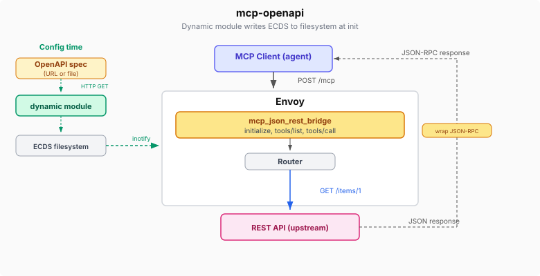
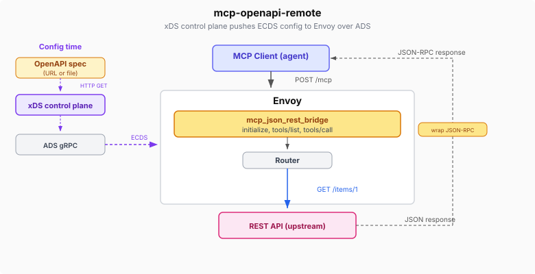

# MCP OpenAPI Extension

This extension exposes REST APIs as [MCP][mcp-spec] tools. Point it at an
OpenAPI spec, get an MCP endpoint.

AI agents speak MCP (JSON-RPC over HTTP), while most backend services speak REST
(OpenAPI). This extension bridges the two without any per-request Go code.

See the [manifest](manifest.yaml) for the user-facing documentation, configuration
reference and examples.

## Local control plane

The extension is control plane logic that runs inside Envoy as a dynamic module.
It loads an OpenAPI spec at config time via [kin-openapi][kin-openapi], generates
the MCP tool definitions and the [`mcp_json_rest_bridge`][envoy-bridge] routing
config, and writes both as [ECDS][ecds] filesystem files. The native
`mcp_json_rest_bridge` filter consumes the generated config and serves the MCP
requests directly.

This is the same pattern Istio [uses to hot-reload Wasm filters][istio-ecds] on
sidecars. The conversion code is normal Go, so the same code can run locally
(this extension) or in an external control plane that pushes ECDS config across
a fleet.



The native filters are declared in the [manifest](manifest.yaml) as
`nativeHttpFilters`. The bridge filter uses ECDS and starts with a no-op default
config, so Envoy does not block waiting for the extension to write the generated
file:

| Filter                                    | Position | Purpose                                                                                      |
|-------------------------------------------|----------|----------------------------------------------------------------------------------------------|
| `envoy.filters.http.mcp`                  | before   | Parses MCP requests and rejects non-MCP traffic                                              |
| `envoy.filters.http.mcp_json_rest_bridge` | after    | Answers `tools/list` locally and transcodes `tools/call` into REST (ECDS: `./mcp-openapi-bridge.json`) |

The bridge answers `tools/list` itself through [`tool_list_local`][bridge-tool-list-local],
which requires Envoy 1.39 or later.

The ECDS file is written to `./mcp-openapi-bridge.json`, relative to the working
directory of the Envoy process. The `bridge_config_path` property changes it, for
example to run several instances of the extension with different specs; the
`path_config_source` of the bridge filter must then be changed to match (e.g. with
`--native-http-filter-after`). Envoy requires the path to contain a directory, hence
the `./`.

The file is written to a temporary file and then renamed over the target. Envoy
only picks up changes to file-based config sources that are moved into place, so
writing the file in place would leave Envoy serving the old tools when the
extension configuration changes while Envoy is running. The rename also prevents
Envoy from reading a partially written file.

The spec itself can be provided inline, from a file or from an HTTP(S) URL. URL
specs are fetched while Envoy loads its configuration, which blocks the main
thread, so the fetch is bounded by `spec.timeout` (30 seconds by default).

### Remote control plane

The conversion code can also run in an xDS control plane (like Istio's istiod).
Instead of writing ECDS files to disk, the control plane pushes
`TypedExtensionConfig` resources to Envoy over ADS gRPC. Envoy's listener
references the bridge filter via `config_discovery` with an ADS config source,
so the bridge config can be updated without rebuilding the listener. The bridge
can answer `tools/list` locally via [`tool_list_local`][bridge-tool-list-local],
as this extension does, or forward it to a managed tools endpoint via
[`tool_list_http_rule`][envoy-bridge-proto].



### Responses without a body

Before Envoy 1.40, the bridge does not handle upstream responses that have no
body, such as `204 No Content` or an error status with an empty body
([1.38 TODO][bridge-headers-only-138], [1.39 TODO][bridge-headers-only-139]).
The MCP client gets an empty response instead of a JSON-RPC result, so calls to
those operations fail. Envoy 1.40 [returns an empty text result][bridge-headers-only-140]
instead, with `isError` set for 4xx and 5xx statuses.

Use Envoy 1.40 or later if the API has operations that return no body. The
e2e tests for this case (`tools_call_headers_only_*`) are skipped on older
Envoy versions.

## Landscape

Comparison with other projects that expose OpenAPI-described REST APIs as MCP
tools, verified against the source of their latest releases as of November 2026:
[agentgateway][agentgateway] v1.7.0, [AWS Labs OpenAPI MCP Server][awslabs-openapi] 1.1.8
and [FastMCP][fastmcp] v4.2.4.

| Feature                           |     This extension      |       agentgateway        |        AWS Labs        |                     FastMCP                     |
|-----------------------------------|:-----------------------:|:-------------------------:|:----------------------:|:-----------------------------------------------:|
| Auto-generates tools from OpenAPI |    [✓][boe-gen-src]     |      [✓][ag-gen-src]      |    [✓][al-gen-src]     |                 [✓][fm-gen-src]                 |
| Works without `operationId`       |    [✓][boe-name-src]    |                           |    [✓][fm-name-src]    |                [✓][fm-name-src]                 |
| Ergonomic schema mapping          |    [✓][boe-flat-src]    |                           |    [✓][fm-flat-src]    |                [✓][fm-flat-src]                 |
| Output schema                     |                         |                           |    [✓][fm-out-src]     |                 [✓][fm-out-src]                 |
| Operation filtering               | [operationId][boe-filter-src] | [tool name (CEL)][ag-filter-src] | [tags][al-filter-src] | [methods, paths, tags, custom][fm-filter-src] |
| Remote URL spec loading           |    [✓][boe-url-src]     |      [✓][ag-url-src]      |    [✓][al-url-src]     |                                                 |
| Swagger 2.0 (JSON and YAML)       |    [✓][boe-sw2-src]     |                           |                        |                                                 |

AWS Labs builds on FastMCP's OpenAPI support ([`FastMCP.from_openapi`][al-gen-src]),
so it inherits FastMCP's tool naming, schema mapping and output schemas.

- **Works without `operationId`**: agentgateway [rejects the spec][ag-opid-src]
  if any operation lacks an `operationId`. The others derive a name from the
  method and path (FastMCP tries the summary first).
- **Ergonomic schema mapping**: e.g. `{"petId": 1}` not `{"path": {"petId": 1}}`.
  agentgateway [nests the arguments][ag-nest-src] under `body`, `path`, `query`
  and `header`.
- **Output schema**: the success response schema, so LLMs know the response shape.
  Not supported yet, as the bridge always returns the response as text content
  ([source][bridge-text-content]).
- **Operation filtering**: agentgateway has no OpenAPI-specific filter, but its
  MCP authorization rules hide tools from `tools/list` with CEL expressions on
  the tool name (the `operationId`), e.g. `mcp.tool.name == "getPetById"`.
  FastMCP's `RouteMap` matches HTTP methods, path regular expressions and tags,
  and `route_map_fn` allows arbitrary logic. AWS Labs exposes only tag filtering
  (`--include-tags` / `--exclude-tags`).
- **Remote URL spec loading**: FastMCP takes an already-loaded spec ([`from_openapi`][fm-spec-src]).
- **Swagger 2.0**: Many APIs, such as [Docker Engine][docker-spec], haven't
  migrated from Swagger 2.0. agentgateway [only parses OpenAPI 3][ag-oas3-src],
  AWS Labs [requires the `openapi` field][al-oas3-src], and FastMCP
  [supports OpenAPI 3.0 and 3.1][fm-oas3-src].

## Testing

Unit tests live next to the code. The end-to-end tests run a real Envoy against
a local httpbin upstream and live in [extensions/tests/e2e](../../tests/e2e/mcp_openapi_test.go):

```sh
make -C extensions/tests/e2e test GO_TEST_ARGS="-run TestMCPOpenAPI -v"
```

[mcp-spec]: https://modelcontextprotocol.io/specification/2025-11-25
[kin-openapi]: https://github.com/getkin/kin-openapi
[ecds]: https://www.envoyproxy.io/docs/envoy/latest/configuration/overview/extension
[istio-ecds]: https://github.com/envoyproxy/envoy/pull/16795
[envoy-bridge]: https://github.com/envoyproxy/envoy/tree/v1.40.0/source/extensions/filters/http/mcp_json_rest_bridge
[envoy-bridge-proto]: https://github.com/envoyproxy/envoy/blob/v1.40.0/api/envoy/extensions/filters/http/mcp_json_rest_bridge/v3/mcp_json_rest_bridge.proto
[bridge-tool-list-local]: https://github.com/envoyproxy/envoy/blob/v1.39.0/api/envoy/extensions/filters/http/mcp_json_rest_bridge/v3/mcp_json_rest_bridge.proto#L212
[bridge-headers-only-138]: https://github.com/envoyproxy/envoy/blob/v1.38.7/source/extensions/filters/http/mcp_json_rest_bridge/mcp_json_rest_bridge_filter.cc#L248
[bridge-headers-only-139]: https://github.com/envoyproxy/envoy/blob/v1.39.4/source/extensions/filters/http/mcp_json_rest_bridge/mcp_json_rest_bridge_filter.cc#L552
[bridge-headers-only-140]: https://github.com/envoyproxy/envoy/blob/v1.40.0/source/extensions/filters/http/mcp_json_rest_bridge/mcp_json_rest_bridge_filter.cc#L830
[bridge-text-content]: https://github.com/envoyproxy/envoy/blob/v1.40.0/source/extensions/filters/http/mcp_json_rest_bridge/mcp_json_rest_bridge_filter.cc#L125
[boe-gen-src]: openapi.go#L97
[boe-name-src]: mcp.go#L12
[boe-flat-src]: openapi.go#L129
[boe-filter-src]: openapi.go#L108
[boe-url-src]: plugin.go#L149
[boe-sw2-src]: openapi.go#L51
[ag-gen-src]: https://github.com/agentgateway/agentgateway/blob/v1.7.0/crates/agentgateway/src/mcp/upstream/openapi/mod.rs#L256
[ag-opid-src]: https://github.com/agentgateway/agentgateway/blob/v1.7.0/crates/agentgateway/src/mcp/upstream/openapi/mod.rs#L275
[ag-nest-src]: https://github.com/agentgateway/agentgateway/blob/v1.7.0/crates/agentgateway/src/mcp/upstream/openapi/mod.rs#L432
[ag-filter-src]: https://github.com/agentgateway/agentgateway/blob/v1.7.0/crates/agentgateway/src/mcp/handler.rs#L821
[ag-url-src]: https://github.com/agentgateway/agentgateway/blob/v1.7.0/crates/agentgateway/src/serdes.rs#L108
[ag-oas3-src]: https://github.com/agentgateway/agentgateway/blob/v1.7.0/crates/agentgateway/src/serdes.rs#L85
[al-gen-src]: https://github.com/awslabs/mcp/blob/2026.11.20261119223057/src/openapi-mcp-server/awslabs/openapi_mcp_server/server.py#L254
[al-filter-src]: https://github.com/awslabs/mcp/blob/2026.11.20261119223057/src/openapi-mcp-server/awslabs/openapi_mcp_server/server.py#L683
[al-url-src]: https://github.com/awslabs/mcp/blob/2026.11.20261119223057/src/openapi-mcp-server/awslabs/openapi_mcp_server/server.py#L635
[al-oas3-src]: https://github.com/awslabs/mcp/blob/2026.11.20261119223057/src/openapi-mcp-server/awslabs/openapi_mcp_server/utils/openapi_validator.py#L55
[fm-gen-src]: https://github.com/PrefectHQ/fastmcp/blob/v4.2.4/fastmcp_slim/fastmcp/server/providers/openapi/provider.py#L61
[fm-name-src]: https://github.com/PrefectHQ/fastmcp/blob/v4.2.4/fastmcp_slim/fastmcp/server/providers/openapi/provider.py#L218
[fm-flat-src]: https://github.com/PrefectHQ/fastmcp/blob/v4.2.4/fastmcp_slim/fastmcp/utilities/openapi/schemas.py#L528
[fm-out-src]: https://github.com/PrefectHQ/fastmcp/blob/v4.2.4/fastmcp_slim/fastmcp/server/providers/openapi/provider.py#L267
[fm-filter-src]: https://github.com/PrefectHQ/fastmcp/blob/v4.2.4/fastmcp_slim/fastmcp/server/providers/openapi/routing.py#L59
[fm-spec-src]: https://github.com/PrefectHQ/fastmcp/blob/v4.2.4/fastmcp_slim/fastmcp/server/server.py#L2607
[fm-oas3-src]: https://github.com/PrefectHQ/fastmcp/blob/v4.2.4/fastmcp_slim/fastmcp/utilities/openapi/parser.py#L62
[agentgateway]: https://github.com/agentgateway/agentgateway
[awslabs-openapi]: https://github.com/awslabs/mcp/tree/main/src/openapi-mcp-server
[fastmcp]: https://github.com/PrefectHQ/fastmcp
[docker-spec]: https://raw.githubusercontent.com/moby/moby/master/api/swagger.yaml
